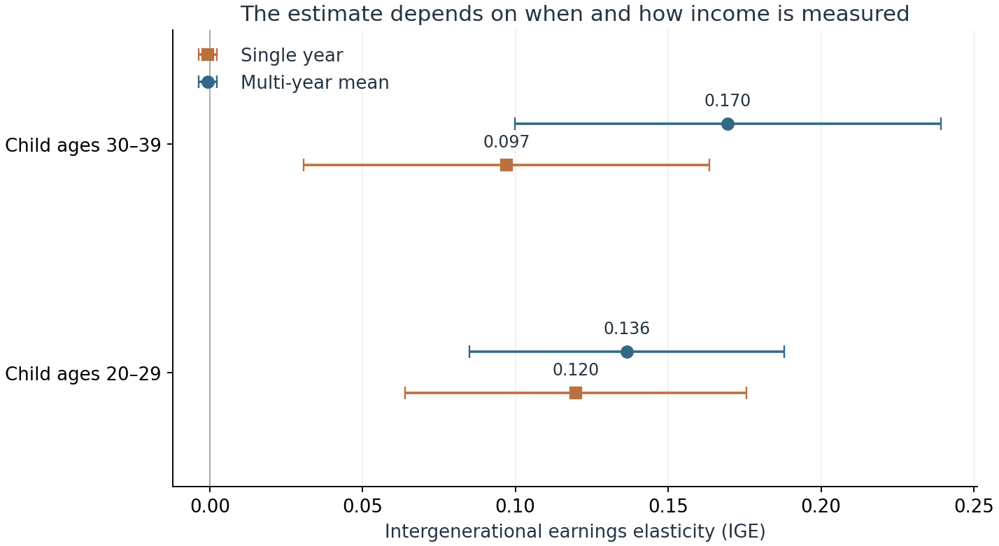

<style>
main.content {font-family: Arial, Helvetica, sans-serif; font-size: 17px; line-height: 1.8;}
h1.title {font-size: 2.2rem; line-height: 1.25;}
main.content h2 {font-size: 1.55rem; margin-top: 2rem; margin-bottom: .8rem;}
main.content p {margin-bottom: 1.1rem; text-align: justify; text-justify: inter-word;}
.quarto-figure {margin-top: 1.5rem; margin-bottom: 1.5rem;}
figcaption {font-size: .9rem; line-height: 1.5;}
table {font-size: .92rem; line-height: 1.5; margin: 1.5rem 0;}
th {background: transparent !important;}
div.sourceCode {margin: 1.2rem 0; font-size: .85rem; line-height: 1.5;}
pre.tutorial-output {background: #f7f8fa; padding: 1rem; font-size: .85rem;}
</style>

## From family links to income persistence

How much does the income relationship between mothers and children change when we measure a different year of their working lives? I use the **NLSY79 and its Child and Young Adult survey** to match biological mothers to their adult children, then compare single-year earnings with multi-year averages. The key is to establish family links first and summarize income histories before combining generations.

## 1. Match people, not current households

The child identifier is **C00001.00**. The child's mother identifier, **C00002.00**, matches **R00001.00** in the maternal file. This is a family-origin link: children remain matched after leaving home. In the prepared tables these fields are named `child_id` and `mother_id`.

The accompanying preparation script converts negative survey codes to missing and deflates annual wages, salary, tips, commissions, and military pay to 2020 dollars. It keeps genuine zeros and one report per person/calendar year. The `tutorial_income` table retains individual years, an age-window label, and `is_single`, which flags the available year closest to the window's target age. No intergenerational match or income average is precomputed in that table.

```python
import sqlite3
import pandas as pd
import numpy as np
import statsmodels.api as sm

con = sqlite3.connect(":memory:")
for table in ("mothers", "children", "tutorial_income"):
    pd.read_csv(f"data/cleaned/{table}.csv").to_sql(table, con, index=False)
```

**SELECT** chooses the fields to return. **JOIN ... ON** attaches each child's mother using the shared identifier. The mother's ID is unique in her table; several children may correctly share it. A join on today's household instead could miss children who moved out.

```python
pairs = pd.read_sql_query("""
    SELECT c.child_id, c.mother_id
    FROM children AS c
    JOIN mothers AS m ON c.mother_id = m.mother_id
    ORDER BY c.child_id
""", con)
pairs.to_sql("pairs", con, index=False)
```

This produces **{{matched_children}} matched children**, before imposing income-coverage requirements. The full script checks that no child is duplicated by the join.

## 2. Aggregate income within each generation

Mother's income is measured at ages **35–39**; child income is measured separately at **20–29** and **30–39**. Age refers to the income year, not simply the interview year. Single-year observations are closest to ages 37, 25, and 35, respectively, with earlier years breaking ties.

**GROUP BY** creates one group per person and age window. **AVG** computes mean annual real income; **COUNT** records the number of observed years. The conditional **MAX** retrieves the one flagged single-year amount. Zero-income years enter the average, while missing years do not. These are averages of observed years, not complete decades.

```python
summaries = pd.read_sql_query("""
    SELECT generation, person_id, window,
           AVG(earnings_real) AS mean_income, COUNT(*) AS n_years,
           MAX(CASE WHEN is_single = 1 THEN earnings_real END) AS single_income
    FROM tutorial_income
    WHERE earnings_real >= 0
    GROUP BY generation, person_id, window
""", con)
summaries.to_sql("summaries", con, index=False)
```

Summarizing first prevents a common mistake: joining every maternal year to every child year would multiply observations and could weight families unevenly.

## 3. Compare estimates on the same sample

Join the three income summaries to each matched pair. Require at least two observed years per window and positive selected incomes for logarithms. We do not replace a selected zero-income year with a more convenient positive one. This leaves **{{n_pairs}} children of {{n_mothers}} mothers** in every regression.

```python
sample = pd.read_sql_query("""
    SELECT p.child_id, p.mother_id,
           m.mean_income AS mother_mean, m.single_income AS mother_single,
           e.mean_income AS early_mean, e.single_income AS early_single,
           l.mean_income AS late_mean, l.single_income AS late_single
    FROM pairs AS p
    JOIN summaries AS m ON m.person_id = p.mother_id AND m.window = 'mother_35_39'
    JOIN summaries AS e ON e.person_id = p.child_id AND e.window = 'child_20_29'
    JOIN summaries AS l ON l.person_id = p.child_id AND l.window = 'child_30_39'
    WHERE m.n_years >= 2 AND e.n_years >= 2 AND l.n_years >= 2
      AND m.single_income > 0 AND e.single_income > 0 AND l.single_income > 0
    ORDER BY p.child_id
""", con)
```

The **intergenerational earnings elasticity (IGE)** is the slope in a regression of log child income on log maternal income. Both generations use either single-year income or arithmetic means, taking logs afterward. Standard errors are clustered by mother to allow correlation between siblings.

```python
rows = []
for stage in ("early", "late"):
    for measure in ("single", "mean"):
        x = sm.add_constant(np.log(sample[f"mother_{measure}"]).to_numpy())
        y = np.log(sample[f"{stage}_{measure}"]).to_numpy()
        fit = sm.OLS(y, x).fit(cov_type="cluster",
                             cov_kwds={"groups": sample.mother_id}, use_t=True)
        low, high = fit.conf_int()[1]
        rows.append({"model": f"{stage}_{measure}", "ige": fit.params[1],
                     "se": fit.bse[1], "ci_low": low, "ci_high": high})
estimates = pd.DataFrame(rows)
con.close()
```

| Child's age window | Single-year IGE | Multi-year IGE |
|:--|--:|--:|
| 20–29 | {{early_single}} | {{early_mean}} |
| 30–39 | {{late_single}} | {{late_mean}} |



The later multi-year estimate, **{{late_mean}}**, associates 1% higher maternal earnings with approximately {{late_mean}}% higher child earnings. It is not a causal effect. Averaging raises the later estimate from {{late_single}} to {{late_mean}}, consistent with single-year fluctuations obscuring persistent differences.

## 4. Separate averaging from lifecycle bias

Temporary income fluctuations and life-cycle bias are different problems. A bonus or a short unemployment spell can make one year's income unrepresentative; averaging several years can reduce this noise. Life-cycle bias arises because earnings at a particular age may not represent lifetime earnings proportionally. People with higher lifetime earnings may start with relatively low pay but experience faster earnings growth. Measuring their income early can therefore understate intergenerational persistence, even without temporary shocks.

The multi-year IGE is {{early_mean}} in the 20s and {{late_mean}} in the 30s. Their paired bootstrap difference interval, **{{late_minus_early_mean_ci}}**, includes zero. This age comparison does not establish lifecycle bias: calendar-period effects and observation patterns also differ.

A constructed benchmark isolates the mechanism. Suppose true lifetime IGE is **0.4**, parental lifetime income is measured correctly, and early-career log earnings respond only half as strongly to lifetime log earnings. Early measurement then gives **0.5 × 0.4 = 0.2**.

| Income measure in the constructed example | IGE |
|:--|--:|
| Lifetime earnings | 0.40 |
| One early-career year, loading 0.5 | 0.20 |
| Several early-career years averaged, same loading | 0.20 |

These are illustrative values, not NLSY estimates. Averaging early years with the same loading retains the distortion. Multi-year averages can better measure long-run economic status by reducing temporary noise, but suitable ages and longer earnings histories remain important.

## Takeaway

Family identifiers establish the links; SQL aggregation determines what income is compared. These unweighted results describe a selected positive-income sample, not national mobility. Topcoding, attrition, and period shocks remain relevant. From 2010, respondents over 30 generally enter a four-year interview cycle, so observation counts differ across windows. A credible comparison needs consistent definitions, the same sample, and an explicit account of when income is measured.

## Data Sources

- [NLS public cohort downloads](https://www.nlsinfo.org/content/access-data-investigator/accessing-data-cohorts): NLSY79 through 2022 and Child/Young Adult through 2020. Selected official columns retrieved October 16, 2026.
- [Linking NLSY79 mothers and their children](https://www.nlsinfo.org/content/getting-started/introduction-to-the-nls/tutorials-and-videos/linking-nlsy79-mothers-and-their-children), National Longitudinal Surveys: identifiers and matching logic.
- NLS income documentation: [NLSY79](https://www.nlsinfo.org/content/cohorts/nlsy79/topical-guide/income/income) and [Child/Young Adult](https://www.nlsinfo.org/content/cohorts/nlsy79-children/topical-guide/income/introduction): income definitions and topcoding.
- [Child/Young Adult sample design](https://www.nlsinfo.org/content/cohorts/nlsy79-children/intro-to-the-sample/sample-design), National Longitudinal Surveys: interview frequency and sample changes.
- [CPIAUCNS](https://fred.stlouisfed.org/series/CPIAUCNS), U.S. Bureau of Labor Statistics via FRED: monthly CPI-U, not seasonally adjusted; annual means calculated for deflation.
- [Haider and Solon (2006)](https://www.nber.org/papers/w11943), *Life-Cycle Variation in the Association between Current and Lifetime Earnings*: interpretation of age-dependent income measurement.
