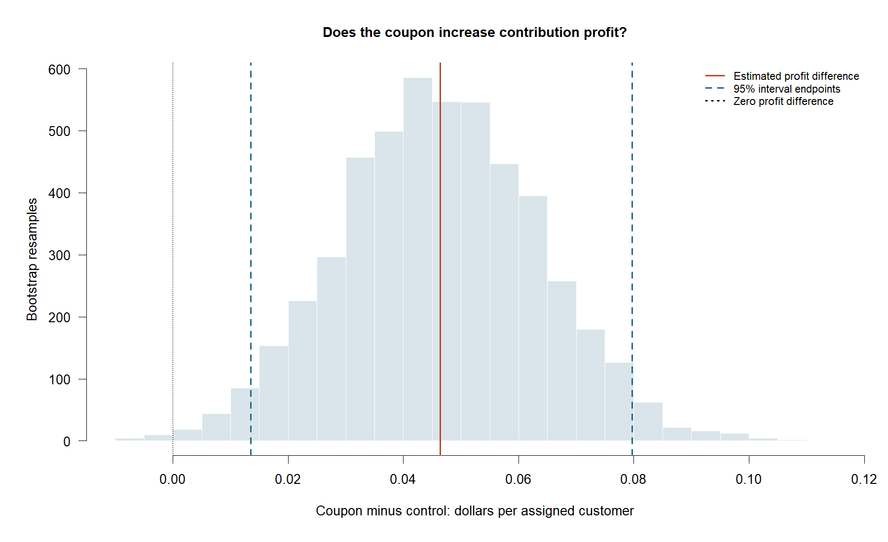
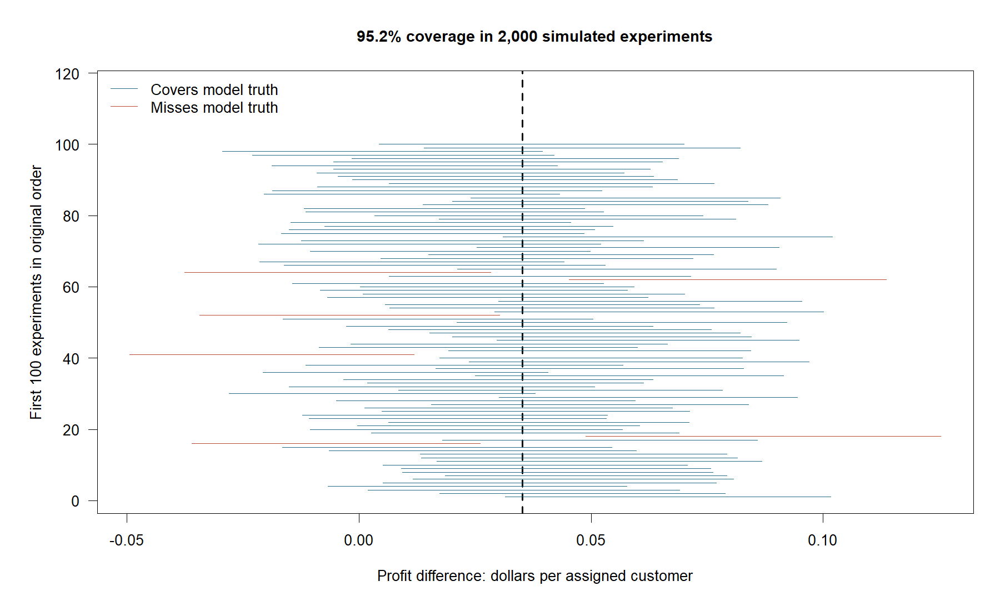
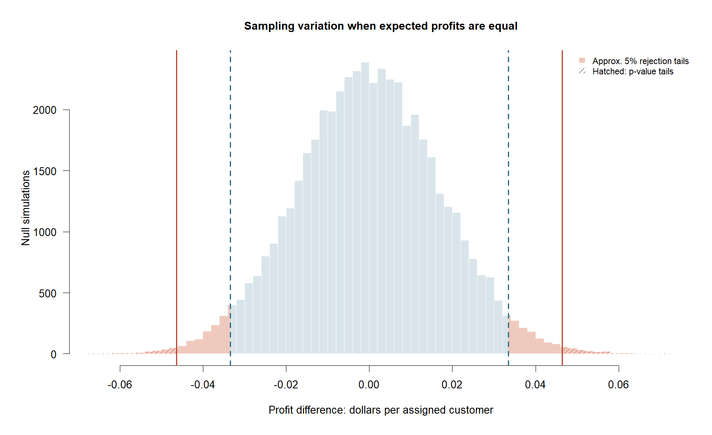

<style>
#title-block-header .quarto-categories { display: none !important; }
main.content {font-family:Arial,Helvetica,sans-serif;font-size:17px;line-height:1.8;}
h1.title {font-size:2.2rem;line-height:1.25;}
main.content h2 {font-size:1.5rem;margin-top:2rem;margin-bottom:.8rem;}
main.content p {text-align:justify;text-justify:inter-word;margin-bottom:1.1rem;}
main.content th, main.content td {font-size:.9rem;line-height:1.6;color:#536174;}
.blog8-tags {display:flex;flex-wrap:wrap;gap:.4rem;margin-bottom:1.4rem;}
.blog8-tags span {font-size:.7rem;text-transform:uppercase;border:1px solid #aab3bd;border-radius:3px;padding:2px 7px;color:#627080;}
@media(max-width:600px) {main.content {font-size:16px;}h1.title {font-size:1.9rem;}}
</style>

<div class="blog8-tags"><span>Simulation</span><span>Bootstrap</span><span>Hypothesis Testing</span></div>

```{r}
source('code/01_analyze.R', local=TRUE)
money <- function(x) sprintf('$%.3f',x)
```

More buyers do not automatically mean more profit: coupons also discount purchases that might have happened anyway. **Does the extra business cover the discount and campaign costs?** This passage uses published experiment results to build a profit simulation and show how uncertain its answer can be.

## Put revenue and costs together

To see whether extra sales cover a coupon’s cost, I use results from Gopalakrishnan and Park’s retail experiment. Suppose the purchase rates are 1.68% without a coupon and 3.65% with a $7 coupon, and 0.58% of recipients redeemed it, matching the rates reported in the study. The profit calculation therefore needs to count both the extra sales and the discounts actually paid.

I simulate 2,000 customers per group using these rates and the study’s reported purchase amounts. Each customer either makes no purchase, buys without redeeming a coupon, or buys with one. This lets me calculate revenue and discount costs separately before accounting for product and campaign costs.

Let **g** be the share of sales revenue left after product and fulfillment costs, before applying the coupon. For example, **g = 10%** means a $30 sale leaves $3 before discounts. A $7 coupon would turn that purchase into a $4 loss. Let **c** be the campaign cost per recipient, including those who do not buy.

Using the study’s reported purchase rates, spending amounts, and redemption rate, the model generates about **$0.758 in additional sales before discounts per recipient**, while redeemed coupons cost about **$0.041 per recipient**. Expected extra profit is therefore **0.758g − 0.041 − c**. With no campaign cost, the offer breaks even at a contribution margin of approximately **5.36%**.

I use **g = 10% and c = $0** for the simulation. These settings imply an expected gain of about **3.5 cents per recipient**. The simulated trial then generates individual purchase outcomes, producing a sample estimate that can differ from this expected value. Resampling those customers shows how uncertain the estimate is.

## How uncertain is the profit estimate?

The generated trial estimates **`r money(s$difference)`** extra profit per customer. I resample customers with replacement separately within each group 5,000 times, preserving each customer's sales and redemption together. The resulting bootstrap distribution describes variation in estimated profit.



The 2.5th and 97.5th percentiles give a 95% interval of **[`r money(s$ci_lower)`, `r money(s$ci_upper)`]**. Here it lies above zero. An interval spanning zero would leave both losses and gains compatible with the procedure, not establish that coupons have no effect.

A confidence interval must also be checked over repeated samples. I generate 2,000 new trials and construct a fresh percentile interval for each using 2,000 bootstrap resamples.



Coverage is **`r sprintf('%.1f',100*s$coverage)`%**, with Monte Carlo standard error `r sprintf('%.2f',100*s$coverage_mcse)` percentage points. The 95% label concerns repeated coverage, not a probability that a fixed parameter lies in one observed interval. Why is the true effect known here? Fixing the published rates and scenario costs defines a simulation whose expected profit difference is `r money(s$simulation_truth)`. Generated samples fluctuate around it. We use that known value to check coverage—not to infer real purchase rates or claim the real-world effect is known.

## Could the result occur with equal profit?

The null hypothesis is that the coupon does not change expected profit per customer. To simulate this, I subtract each group’s average profit from its customer outcomes, giving both groups a mean of zero. I then resample within each group 50,000 times and calculate the difference in means to show how sampling variation alone could produce a profit difference.



At the 5% significance level, we reject the null when the absolute profit difference exceeds the boundary marked by the blue dashed lines. The observed difference falls in the rejection region, with a two-sided p-value of 0.0067. About 0.67% of the simulated null differences were at least as far from zero as the observed result. This provides evidence of a profit increase under the assumed 10% margin and zero campaign cost.

## Would the offer pay for itself?

Adjust the contribution margin and campaign cost below to see whether the coupon pays for itself. The tool shows the estimated profit change and its 95% bootstrap interval. Purchase behavior stays fixed as costs change.

```{r, results='asis'}
cat(widget)
```

At a **10% contribution margin and zero campaign cost**, the coupon pays for itself in the model, generating about **3.5 cents in expected extra profit per recipient**. This leaves up to 3.5 cents per recipient to cover campaign costs; spending more would eliminate the expected gain. For example, at a campaign cost of 5 cents per recipient, the offer would lose about 1.5 cents per recipient on average, despite increasing purchases. The retailer should compare its own campaign cost with this threshold before expanding the offer.

Use the retailer’s own margin and campaign cost to assess the offer. A positive estimate indicates an expected gain; an interval that crosses zero means the simulated trial does not clearly establish profitability. These calculations cover immediate purchases, excluding future sales.

## Sources

- Gopalakrishnan, A., and Park, Y.-H. [The Impact of Coupons on the Search-to-Purchase Funnel: Theory and Empirical Evidence](https://thearf-org-unified-admin.s3.amazonaws.com/MSI/2020/06/MSI_Report_19-106-1.pdf), MSI Report 19-106, printed pages 20 and 24 and Table 2. Transcribed inputs are in `data/raw/published_inputs.csv`; customer records are simulated.
- R documentation: [resampling](https://stat.ethz.ch/R-manual/R-devel/library/base/html/sample.html), [multinomial simulation](https://stat.ethz.ch/R-manual/R-devel/library/stats/html/Multinom.html), and [quantiles](https://stat.ethz.ch/R-manual/R-devel/library/stats/html/quantile.html).
