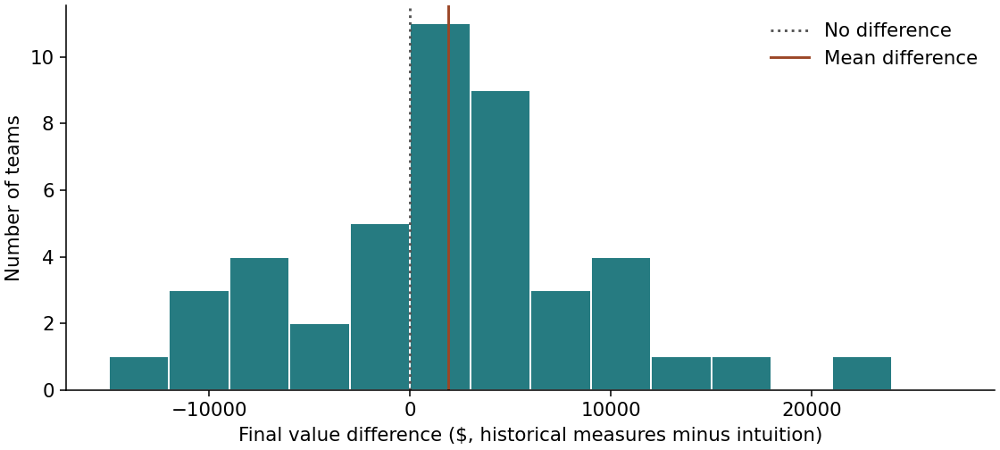
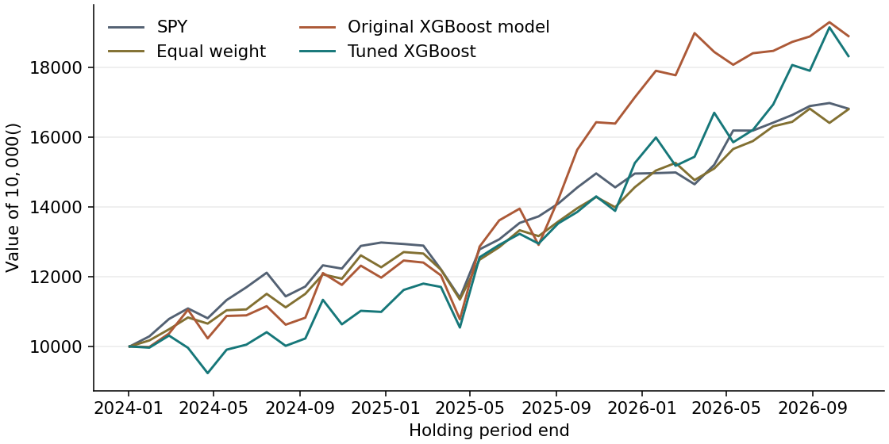

Stock Return PredictionGradient BoostingPortfolio Backtesting

## How We Picked Stocks in the Classroom Experiment

In our class stock-market game, each team started two portfolios with $100,000 apiece. Teams picked the first portfolio by intuition and used historical measures to help choose the second. The Sharpe ratio measures excess return per unit of volatility. Jensen’s alpha asks how much return remains after accounting for market exposure. Correlations show whether stocks tend to move together. The game asked whether using those measures would improve performance over roughly two months. The same team built both portfolios, so the natural comparison is the difference within each team.

## What happened in class?

Across the 45 teams with results for both portfolios, the intuition-based portfolios averaged $101,179, while the portfolios based on historical measures averaged $103,087. The portfolio based on historical measures finished ahead for 30 teams. The mean within-team difference was $1,909, with a 95% paired *t* confidence interval from −$380 to $4,197 (two-sided *p* = 0.100). The interval includes zero, so the results are consistent with a modest loss or a gain from using historical measures. Both portfolios were evaluated over the same period. Because teams faced the same market conditions and may have held some of the same stocks, their portfolio differences may be correlated across teams, which could weaken the independence assumption behind the paired test.

Predicting returns is difficult because prices can already reflect publicly available information, and new information can move them before a model has time to react. A pattern that looked useful in one market can also fade. Adding trees gives a model more ways to pick up both genuine patterns and noise.

## Rebuilding the Original Forecasting Model

The original XGBoost model adds trees that learn from earlier prediction errors. Its inputs include lagged price changes, volatility, market-adjusted returns and the raw price and volume columns used in the original model. I reproduced the model’s settings and features in Python using the same XGBoost engine. The dataset covers 95 stocks plus SPY. At each signal close, the model predicts the return from the next trading day’s close to the close 20 trading sessions after the signal.

I tested whether the model would generalize better if it learned from comparable signals across stocks. I removed raw price and volume levels, expressed momentum as later price divided by earlier price minus one, and added relative volume and stock and market trends. I selected tree depth, tree count and learning rate on 2023 data after training on 2022. Validation chose 50 trees at depth 1 and learning rate 0.02. I then refit both specifications using data through 2023 and tested them from 2024 onward. At each split I excluded training labels whose holding periods reached into the next evaluation period.

## Forecast accuracy

**Table 1. Performance on 65,645 held-out stock-day forecasts**

| Model | RMSE | MAE | R² vs. historical mean | Mean daily rank correlation |
| :-- | --: | --: | --: | --: |
| Historical mean | 8.84% | 6.39% | 0.000 | — |
| Original XGBoost model | 9.34% | 6.81% | -0.115 | 0.032 |
| Tuned XGBoost | 8.87% | 6.41% | -0.007 | 0.030 |

Tuning lowered RMSE from 9.34% to 8.87%, but the historical mean still had the lowest error at 8.84%. The mean daily rank correlations were both close to zero, and the tuned model ranked stocks slightly worse than the original. A forecast can get closer to the average realized return without getting better at picking winners. These daily forecasts also share overlapping holding periods, so the scores summarize this sample.

## Would the forecasts have made money?

Every 19 trading sessions, each model selected its ten highest forecasts and weighted positive forecasts proportionally, falling back to equal weights if all ten were nonpositive. I compared the strategies with SPY and an equal-weight portfolio of the available stocks. All strategies used the same 37 nonoverlapping holding periods ending October 22, 2026 and paid 10 basis points per dollar traded.

**Table 2. Held-out portfolio performance after costs**

| Strategy | Annualized return | Annualized volatility | Max drawdown | Ending value |
| :-- | --: | --: | --: | --: |
| SPY | 20.47% | 12.94% | -12.20% | $16,813 |
| Equal weight | 20.43% | 11.78% | -10.72% | $16,797 |
| Original XGBoost model | 25.62% | 20.81% | -13.50% | $18,894 |
| Tuned XGBoost | 24.24% | 20.62% | -10.66% | $18,321 |

Both model portfolios earned higher returns than SPY in this sample, with substantially higher volatility. The original portfolio finished ahead of the tuned portfolio, even though its predictions had larger errors. At 25 basis points per dollar traded, the original and tuned strategies returned 22.27% and 21.32% annually, respectively, compared with 20.41% for SPY and 20.22% for equal weight. Higher costs narrowed the advantage. The short evaluation period and fixed list of large companies limit what these results tell us about other market conditions.

I would judge a forecast and a portfolio separately. In this test, tuning improved return estimates relative to the original model, while the historical mean still forecast returns better and the original stock-selection rule earned more.

## Sources

- University of Pennsylvania course materials. *UPenn XGBoost Stock Prediction*, the original R script used as the basis for the forecasting model.
- Yahoo Finance. Historical daily prices for the 95 stocks in the study and SPY. [Yahoo Finance](https://finance.yahoo.com/)
